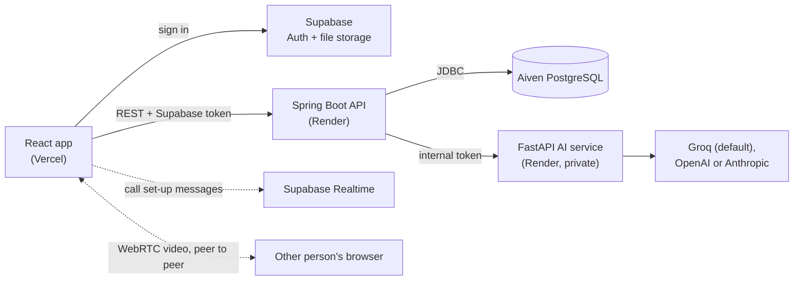

# PawConnect

**Tele-veterinary care for dogs.** Dog parents and verified vets meet on private video consultations, message
about each appointment and share consent-based health records. NGOs run street-dog welfare campaigns.

PawConnect has three kinds of account. Each person sees only their own portal:

| Role | What they can do |
| --- | --- |
| **Dog parent** | Add dogs, log symptoms, vaccinations and medication, get AI symptom screening, grant or revoke a vet's access, book appointments, message and video-call the vet |
| **Veterinarian** | See a dog's record only while the owner's consent is active, confirm appointments, message and video-call owners, add notes and follow-ups |
| **NGO** | Run street-dog campaigns and publish impact reports (after admin verification) |

Vets and NGOs must be verified by an admin before they can see records or publish campaigns.

> **Status:** a working foundation, not a finished product. The video consultations, appointments, messaging,
> consent, AI screening, reminders, admin verification and NGO campaigns are built. The pet store, PawCoins
> rewards, donations, community events, in-app AI chat and prescriptions are **not built yet**, and neither are the
> early-warning and prevention features planned for tick-borne disease (see [Roadmap](#roadmap) and
> [Future scope](#future-scope-early-detection-and-prevention)). The code has been checked in a sandbox but the full
> stack has not yet been started against live services (see [Testing](#testing-and-what-has-been-verified)).

## Why this project exists

Tick-borne diseases such as babesiosis and ehrlichiosis are hard to catch early. The first signs (tiredness, lower
appetite, a mild fever) look like many ordinary things, and by the time pale or yellow gums appear the illness is
often advanced. PawConnect aims to close that gap: help dog parents notice small changes sooner, prevent infestations
in the first place, and get the right information to a vet quickly.

## How it fits together



- **Supabase** handles accounts (sign-up, login, password reset) and the private bucket for verification documents.
  It stores no application data.
- **The API** validates the Supabase token on every request, reads the person's role from the `profiles` table and
  enforces ownership, consent and verification rules. Clients never talk to the database.
- **Aiven PostgreSQL** holds all application data. Flyway migrations run when the API starts.
- **The AI service** scores symptoms with transparent rules, then asks an LLM to explain the result in plain words.
  It never diagnoses, and it falls back to a fixed template if the LLM is unavailable.

## Tech stack

| Part | Technology |
| --- | --- |
| Frontend | React 18, Vite 5, Tailwind CSS 3, React Router 6, React Hook Form + Zod, `@supabase/supabase-js` |
| Backend | Java 17, Spring Boot 3.3, Spring Security (OAuth2 resource server), JDBC, Flyway, Maven |
| Database | PostgreSQL on Aiven |
| Auth and files | Supabase Auth and Storage |
| AI service | Python 3.11, FastAPI, Groq by default (OpenAI and Anthropic supported) |
| Video | WebRTC between browsers, signalling over Supabase Realtime |
| Deployment | Render (API and AI service, via `render.yaml`), Vercel (frontend) |

## Repository layout

```text
.
├── backend/            Spring Boot API (Dockerfile, Flyway migrations in src/main/resources/db/migration)
├── ai-service/         FastAPI risk screening and chat service (Dockerfile, unit tests)
├── frontend/           React app (src/telehealth holds the video-call code)
├── supabase/           SQL to run in the Supabase project (verification-document bucket and policies)
├── scripts/            check-services.sh: tests Aiven, Supabase, the API and the AI service
├── docs/               database.md: database diagram (generated from the migrations)
├── archive3-extras/    A second codebase with store, rewards, events and prescriptions (not merged, see its README)
└── render.yaml         Render blueprint for the API and the AI service
```

## Getting started

### Prerequisites

Java 17, Maven 3.9, Node 18 or newer, Python 3.11, a Supabase project and an Aiven PostgreSQL service.
(The Dockerfiles in `backend/` and `ai-service/` build the same services if you prefer containers.)

### 1. Supabase

1. Create a project and enable **Email** sign-in. Turn on **Confirm email** for production.
2. In the SQL Editor run [`supabase/004_verification_storage.sql`](supabase/004_verification_storage.sql). It creates the
   private `verification-docs` bucket and its policies.
3. Copy the project URL and the anon key (Project Settings, API). Keep the `service_role` key for the backend only.
4. Add your frontend address to **Site URL** and **Redirect URLs**.

### 2. Aiven PostgreSQL

1. Create a PostgreSQL service and wait until it is **Running**.
2. Copy the host, port, user (`avnadmin`), password and database (`defaultdb`). SSL is required.
3. Allow connections from the machine or host that runs the API.

The API creates every table itself on first start; you do not run any SQL on Aiven by hand.

### 3. Run the backend

```bash
cd backend
export DB_URL="jdbc:postgresql://<HOST>:<PORT>/defaultdb?sslmode=require"   # must start with jdbc:postgresql://
export DB_USER=avnadmin
export DB_PASSWORD='<password>'
export SUPABASE_URL=https://<project-ref>.supabase.co
export SUPABASE_SERVICE_ROLE_KEY=<service role key>
export AI_SERVICE_BASE_URL=http://localhost:8000
export AI_INTERNAL_TOKEN=dev-token
export CALL_ROOM_SECRET=<at least 32 random characters>
export CORS_ALLOWED_ORIGINS=http://localhost:5173
mvn spring-boot:run
```

Look for `Successfully applied 3 migrations` in the log, then check
`curl http://localhost:8080/api/actuator/health`. The API is served under `/api`.

### 4. Run the AI service

```bash
cd ai-service
pip install -r requirements.txt
export AI_INTERNAL_TOKEN=dev-token          # same value as the backend
export GROQ_API_KEY=<your key>              # optional: without it, results use fixed explanation templates
uvicorn main:app --port 8000
```

Check the model name in `AI_MODEL_GROQ` against your Groq account before deploying; model names and limits change.

### 5. Run the frontend

```bash
cd frontend
cp .env.example .env        # then fill in the three values below
npm install
npm run dev                 # http://localhost:5173
```

### 6. Create the first admin

Sign up with your own account, then run this in Aiven's query tool and sign in again:

```sql
update public.profiles set is_admin = true where email = 'you@example.com';
```

### 7. Check everything is wired up

```bash
export DATABASE_URI='postgres://avnadmin:<password>@<host>:<port>/defaultdb?sslmode=require'
export SUPABASE_URL=https://<project-ref>.supabase.co
export SUPABASE_ANON_KEY=<anon key>
export BACKEND_URL=http://localhost:8080/api
./scripts/check-services.sh
```

It prints PASS or FAIL for the database login, applied migrations, Supabase keys, API health, the 401 for
unauthenticated requests, CORS and the AI service, with the likely cause of each failure.

## Configuration

**Backend**

| Variable | Purpose |
| --- | --- |
| `DB_URL`, `DB_USER`, `DB_PASSWORD` | Aiven connection (JDBC form, `sslmode=require`) |
| `SUPABASE_URL` | Project URL; the API fetches Supabase's signing keys from here |
| `SUPABASE_JWT_SECRET` | Only for older Supabase projects that still sign tokens with a shared secret |
| `SUPABASE_SERVICE_ROLE_KEY` | Server-only. Lets admins open verification documents. Never put it in the frontend |
| `CORS_ALLOWED_ORIGINS` | The exact frontend origin, with no trailing slash |
| `AI_SERVICE_BASE_URL`, `AI_INTERNAL_TOKEN` | Where the AI service is, and the shared secret sent to it |
| `CALL_ROOM_SECRET` | 32+ characters; enables video consultations. Keep it stable. If unset, only the call endpoint answers 503 |
| `SMTP_HOST`, `SMTP_PORT`, `SMTP_USER`, `SMTP_PASSWORD` | Optional. Without them, notifications show in the app but no email is sent |
| `PORT` | Defaults to 8080 |

**AI service**

| Variable | Purpose |
| --- | --- |
| `AI_PROVIDER` | `groq` (default), `openai` or `anthropic` |
| `GROQ_API_KEY`, `AI_MODEL_GROQ` | Groq key and model (default `llama-3.1-8b-instant`) |
| `OPENAI_API_KEY`, `OPENAI_MODEL` | Optional fallback provider |
| `ANTHROPIC_API_KEY`, `ANTHROPIC_MODEL` | Optional fallback provider |
| `AI_INTERNAL_TOKEN` | Must match the backend |
| `CHAT_DAILY_LIMIT` | Per-user daily chat limit (default 30) |
| `ENVIRONMENT` | `production` on Render |

**Frontend** (`frontend/.env`)

| Variable | Purpose |
| --- | --- |
| `VITE_SUPABASE_URL`, `VITE_SUPABASE_ANON_KEY` | Public Supabase values (the anon key is meant to be public) |
| `VITE_API_BASE_URL` | e.g. `http://localhost:8080/api` |
| `VITE_TURN_URL`, `VITE_TURN_USERNAME`, `VITE_TURN_CREDENTIAL` | Optional TURN relay for video calls on strict networks |

Never commit `.env` files. `render.yaml` also lists `RAZORPAY_KEY_ID` and `RAZORPAY_KEY_SECRET`; nothing uses them yet.

## Video consultations

1. A dog parent books an appointment and the vet confirms it.
2. From 15 minutes before the slot until an hour after it starts, a **Join video consult** button appears on the
   appointment card for both people.
3. The button opens `/consult/:appointmentId`. The page calls `GET /api/appointments/{id}/call-room`, which answers
   only for the dog's owner, or the verified vet with active consent, on a confirmed appointment inside the window.
   Each join is written to the audit log.
4. The reply holds a private room key. The two browsers use it to name a Supabase Realtime channel, swap set-up
   messages, then send video and audio directly to each other. **Nothing is recorded.**

Limits: one-to-one only; anyone holding a room key can join that room, and the API gives it only to authorised
people; callers on strict networks may need a TURN relay (set the `VITE_TURN_*` variables).
Video consultations are shown with an emergency notice and are not for emergencies.

## Access rules

- A dog parent sees only their own dogs and records. Vets and NGOs have no access to them unless consent is granted.
- A vet can see, message, join calls about or act on an appointment only while **verified** and while the owner's
  **consent is active**. Revoking consent removes access immediately.
- Appointments can only be booked with a verified vet who has active consent for that dog.
- Only verified NGOs can publish campaigns and impact reports.
- Reminders are sent once per item. Every record view, consent change and call join is audit-logged, and the audit
  log is append-only (database triggers block edits and deletes).
- Signed-out visitors see the home page and the three portal logins. Opening `/dashboard` while signed out sends
  you to the home page, and a vet using the dog-parent login (or the reverse) is turned away.

## Database

16 tables in Aiven PostgreSQL, created by `V1__identity.sql`, `V2__health_consent_audit.sql` and
`V3__features.sql`. See [`docs/database.md`](docs/database.md) for the diagram. `profiles.id` equals the Supabase user
id; there is no foreign key to Supabase's own tables. Do not edit an applied migration: add `V4__...sql` instead.

## API

All paths are under `/api` and need a Supabase access token unless noted. Request and response bodies use snake_case.

<details>
<summary>All 37 endpoints</summary>

| Method | Path | Module |
| --- | --- | --- |
| GET    | `/admin/verifications` | admin |
| POST   | `/admin/verifications/{profileId}` | admin |
| GET    | `/admin/verifications/{profileId}/document-url` | admin |
| GET    | `/dogs/{dogId}/medications` | care |
| POST   | `/dogs/{dogId}/medications` | care |
| GET    | `/dogs/{dogId}/vaccinations` | care |
| POST   | `/dogs/{dogId}/vaccinations` | care |
| DELETE | `/medications/{id}` | care |
| DELETE | `/vaccinations/{id}` | care |
| GET    | `/consents/vets` | consent |
| POST   | `/consents/{grantId}/revoke` | consent |
| GET    | `/dogs/{dogId}/consents` | consent |
| POST   | `/dogs/{dogId}/consents` | consent |
| GET    | `/dogs` | dog |
| POST   | `/dogs` | dog |
| GET    | `/dogs/{dogId}/symptoms` | health |
| POST   | `/dogs/{dogId}/symptoms` | health |
| GET    | `/campaigns` | ngo |
| GET    | `/ngo/campaigns` | ngo |
| POST   | `/ngo/campaigns` | ngo |
| GET    | `/ngo/campaigns/{id}/reports` | ngo |
| POST   | `/ngo/campaigns/{id}/reports` | ngo |
| POST   | `/ngo/campaigns/{id}/status` | ngo |
| GET    | `/notifications` | notifications |
| POST   | `/notifications/read-all` | notifications |
| POST   | `/notifications/{id}/read` | notifications |
| GET    | `/me` | profile |
| POST   | `/me/verification-document` | profile |
| GET    | `/appointments` | vetconnect |
| GET    | `/appointments/{id}/call-room` | vetconnect |
| POST   | `/appointments/{id}/cancel` | vetconnect |
| POST   | `/appointments/{id}/decision` | vetconnect |
| GET    | `/appointments/{id}/messages` | vetconnect |
| POST   | `/appointments/{id}/messages` | vetconnect |
| POST   | `/dogs/{dogId}/appointments` | vetconnect |
| GET    | `/vet/dogs/{dogId}/record` | vetconnect |
| GET    | `/vet/patients` | vetconnect |

</details>

## Deployment

1. **Aiven:** service Running, connection details copied.
2. **Render:** create a Blueprint from `render.yaml`. Set the secrets marked `sync: false` (database, Supabase,
   CORS origin, `AI_INTERNAL_TOKEN`, `GROQ_API_KEY`). `CALL_ROOM_SECRET` is generated for you. Render's private
   services need a paid plan, so the AI service is set to `starter`. The free web service sleeps when idle and the
   first request afterwards can take up to a minute.
3. **Vercel:** import the `frontend` folder and set the `VITE_*` variables. `vercel.json` rewrites every path to
   the app.
4. **Supabase:** add the Vercel URL to Site URL and Redirect URLs.

## Testing and what has been verified

```bash
# AI service: 32 unit tests (risk scoring, safety guard, explanations, cache, rate limit)
cd ai-service && python -m unittest tests.test_risk tests.test_explain_guard tests.test_infra

# Backend: tests for the video room key and join window
cd backend && mvn test
```

Checked in a sandbox without Maven, npm installs, PostgreSQL or any live service:

- **AI service:** all 32 unit tests pass. The FastAPI app itself was not started.
- **Video calls:** two real browser tabs with fake cameras connected, decoded video, muted, hung up and rejoined.
  The connection through the real Supabase Realtime service has not been tested.
- **Backend:** no syntax errors, every SQL string matches the migrations, and the room-key and join-window logic
  passes. Spring Boot was not started and the migrations were not run against PostgreSQL.
- **Frontend:** the app parses, every import resolves, every API call has a matching backend route, and in a
  browser with sample data the home page loads first, the dashboards require login, and each role sees only its own.

The first real build, the first migration run and one real call between two devices on different networks are where
any remaining problems will show up. Run `scripts/check-services.sh` after deploying.

## Security notes

- Only the backend connects to Aiven. Keep the database password, `SUPABASE_SERVICE_ROLE_KEY` and `CALL_ROOM_SECRET`
  out of the frontend, the repository and logs. Use Render and Vercel secrets.
- The role a person picks at sign-up is stored in their Supabase metadata and becomes their profile role on first
  use. It does not give clinical access, because vets and NGOs stay pending until verified. Before a public launch,
  move role assignment to `app_metadata` (only the server can write that) or create role profiles through a server
  endpoint.
- Row-level security is not used on Aiven; access control lives in the backend services.

## Roadmap

**Platform features**

- [ ] PawCoins rewards and wallet, and donating coins to street-dog campaigns (the home page mentions
      1 PawCoin = 1 street-dog meal; it is not implemented)
- [ ] Pet store: catalogue, cart, checkout
- [ ] Community events and RSVPs
- [ ] AI chat assistant in the app (the AI service already has a `/chat` endpoint)
- [ ] Digital prescriptions

**Quality and security**

- [ ] First end-to-end run of the full stack against live services, including a real video call between two
      devices on different networks
- [ ] Backend and frontend test suites, including the consent flow against a PostgreSQL container
- [ ] Move role assignment to `app_metadata`

**Health monitoring and prevention**

- [ ] See [Future scope](#future-scope-early-detection-and-prevention) below

The store, rewards, events and prescriptions already exist in [`archive3-extras/`](archive3-extras/) for a different
database design and need porting. The store and rewards stay on hold until the health-monitoring core below is solid.

## Future scope: early detection and prevention

None of the following is built yet. It is planned work, motivated by how hard tick-borne illness is to catch early
(see [Why this project exists](#why-this-project-exists)). Each item fits the existing architecture, and new tables
would arrive as a `V4__...sql` migration.

### 1. Tick-borne red-flag rules in AI screening

The AI service already scores symptoms with transparent rules. The plan is to add rules for tick-borne and related
conditions (for example babesiosis, ehrlichiosis and other causes of jaundice or anemia), including:

- Yellow gums, skin or eyes always produce an urgent "see a vet today" result, whatever the other inputs are.
- Pale gums together with lethargy, fever or poor appetite produce an urgent result.
- A recent tick history raises the score when combined with any of the signs above.
- Nosebleeds, bruising or tiny red spots on the gums are flagged as possible bleeding or low platelets.
- Dark orange or brown urine and pale stools are flagged as possible liver or blood-breakdown signs.

These rules would be **hard overrides**: the LLM only explains the result and can never soften or remove an urgent
message. The existing fixed-template fallback keeps working when the LLM is unavailable.

### 2. Parasite prevention tracking

- A tick and flea **preventive** record type next to vaccinations and medication, with recurring reminders (monthly
  or every few months, depending on the product).
- A **tick found** log with date and body location (ears, neck, between the toes, skin folds).
- A prompt to treat the home and kennel when ticks are found repeatedly, since most of the tick population lives in
  the surroundings and not on the dog.

### 3. Gum-colour and baseline check-ins

A short daily or weekly check-in covering appetite, water intake, energy, gum colour (with a reference chart or
photo) and temperature where the owner has a thermometer. Changes are compared against the dog's own baseline, so
small drifts over several days stand out, and a worsening trend can trigger a notification or a suggestion to book
an appointment.

### 4. Regional education content

Short, region-aware guides for dog parents and for NGO campaigns, covering:

- Brown dog ticks (they live indoors and in kennels, not only in grass) and year-round prevention in warm climates.
- Early signs of babesiosis and ehrlichiosis, and when to see a vet the same day.
- Home and kennel clean-up steps.

### 5. Emergency path

When screening returns an urgent result, show a prominent action to find a nearby vet or emergency clinic, and make
it easy to share the symptom log and check-in history with that vet. This complements the emergency notice already
shown on video consultations, which are not for emergencies.

### Design and safety notes for these features

- Red-flag rules and thresholds should be **reviewed by a licensed veterinarian** before real owners rely on them.
- All new data keeps the existing rules: owner-only by default, vet access only with active consent, and audit
  logging of record views.
- Screening stays decision support only. It does not diagnose, and a veterinarian remains responsible for diagnosis
  and treatment.

## Contributing and license

Issues and pull requests are welcome. No license has been chosen yet; add a `LICENSE` file before publishing the
repository publicly.

Veterinary decision support only: nothing in PawConnect is a diagnosis, and a veterinarian remains responsible for
diagnosis and treatment.
